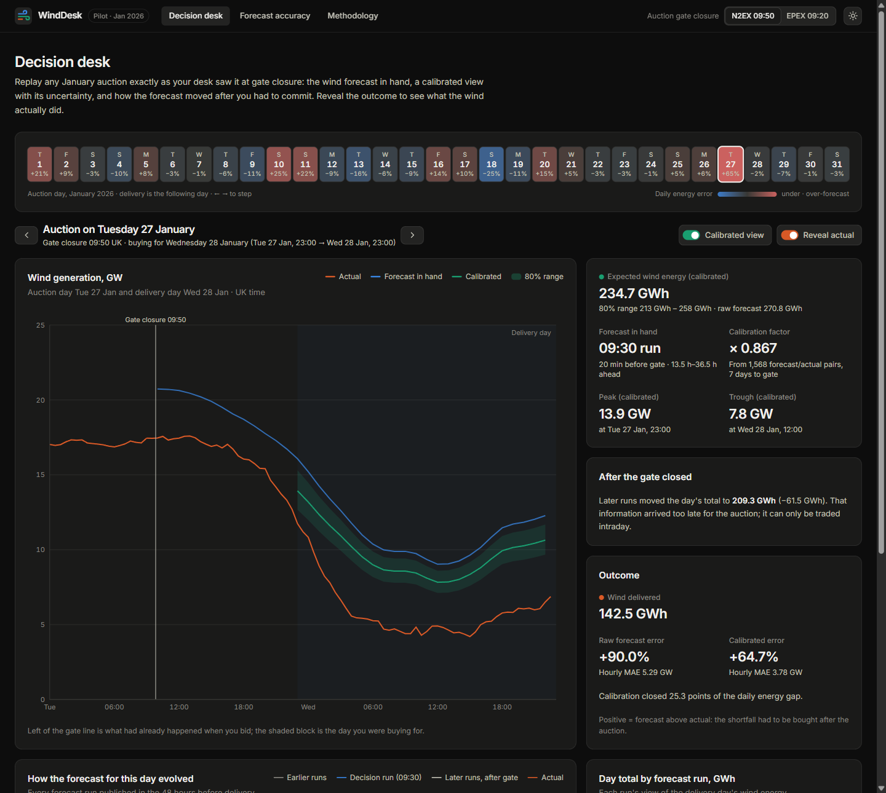

# WindDesk: GB day-ahead wind forecast monitor

A web app for a UK utility's day-ahead power-buying desk. It shows **which wind forecast was in hand when each
day-ahead auction closed** and **how accurate that forecast turned out to be**, for every purchase decision made in
January 2026. Data: Elexon BMRS `WINDFOR` (national wind forecast) and `FUELHH` (wind outturn) only.

- **Live app:** `<add your Vercel or Heroku URL here>`
- **Demo video:** `<add your unlisted YouTube link here>`



## What it shows

| View | Question it answers |
|---|---|
| **Decision desk** | "What did we know at 09:50 gate closure, and what happened next?" Replays any January auction: the forecast run in hand, a calibrated forecast with an 80% range, actuals known at the time, how later runs moved after the gate, and (on request) the real outcome. |
| **Forecast accuracy** | "How much should we trust the forecast?" MAE, bias, RMSE, P90 error, error growth with lead time, error by hour and by wind level, daily energy error, plus auto-generated findings. |
| **Methodology** | Every definition and assumption, written for the desk. |

Headline findings for January 2026 (N2EX 09:50 gate):

- The forecast in hand at gate closure **ran 15% high**: +1.73 GW mean error, over-forecasting in 84% of delivery hours. Taken at face value, this means systematic under-buying.
- The gap **grows with wind**: when 15 GW or more was forecast, only 85% of it was delivered.
- A transparent **7-day trailing calibration** that uses only data available at gate closure cuts MAE from 1.99 to 1.34 GW (**−32%**). That beats the raw forecast published one hour before delivery.
- Its **80% range contained 80.2% of outcomes**, so it is usable for sizing a shortfall buffer.

Details: [docs/ANALYSIS.md](docs/ANALYSIS.md).

## Run it

### Docker (one command)

```bash
docker compose up --build
# open http://localhost:8000
```

A single image builds the React app and serves it, plus the API, from one FastAPI process. No credentials are needed:
the Elexon API is public, and the January 2026 data ships as a 130 KB snapshot in the repo.

### Local development (hot reload)

Prerequisites: Python 3.11+ and Node 22+.

```bash
# Terminal 1: API on :8000
cd backend
python -m venv .venv
source .venv/bin/activate            # Windows: .venv\Scripts\activate
pip install -r requirements-dev.txt
uvicorn app.main:app --reload

# Terminal 2: UI on :5173 (proxies /api to :8000)
cd frontend
npm ci
npm run dev
```

API docs (Swagger UI): http://localhost:8000/api/docs

### Tests and checks

```bash
cd backend  && ruff check . && ruff format --check . && pytest --cov=app
cd frontend && npm run lint && npm test && npm run build
```

CI ([.github/workflows/ci.yml](.github/workflows/ci.yml)) runs all of the above, checks that the generated API types
are up to date, and smoke-tests the Docker image.

## Repository layout

```
.
├── backend/                     Python API (FastAPI + pandas)
│   ├── app/
│   │   ├── main.py              App factory: routes, middleware, serves the built frontend
│   │   ├── config.py            Settings from WINDDESK_* environment variables
│   │   ├── openapi.py           Exports the OpenAPI schema used to generate frontend types
│   │   ├── api/
│   │   │   ├── routes.py        HTTP endpoints (thin: validate, delegate, return)
│   │   │   └── schemas.py       Pydantic response models = the API contract
│   │   ├── services/
│   │   │   └── analytics.py     Builds each view from the domain functions; memoises results
│   │   ├── domain/              Pure business logic, no I/O
│   │   │   ├── market.py        GB day-ahead rules: gate closures, 23:00–23:00 delivery day, UK time
│   │   │   ├── selection.py     "Latest forecast published by the cutoff" (as-of selection)
│   │   │   ├── metrics.py       Error statistics, histograms, hour/level profiles, daily energy
│   │   │   └── calibration.py   Causal (no look-ahead) multiplicative calibration + 80% range
│   │   └── data/
│   │       ├── elexon.py        Elexon BMRS client: chunked, retried, schema-validated
│   │       ├── frames.py        Canonical DataFrame shapes and cleaning
│   │       ├── store.py         Snapshot load/save; live fetch with cache
│   │       └── ingest.py        CLI to refresh the snapshot: python -m app.data.ingest
│   ├── data/snapshot/           Raw Elexon rows for the pilot window (+ manifest.json)
│   ├── tests/                   pytest suite: domain rules, API contract, snapshot invariants
│   ├── requirements.txt         Pinned runtime dependencies
│   └── pyproject.toml           Ruff and pytest configuration
├── frontend/                    React 19 + TypeScript + Vite
│   ├── src/
│   │   ├── main.tsx, App.tsx    Entry point and routes (non-landing pages lazy-loaded)
│   │   ├── api/                 Typed client, TanStack Query hooks, generated schema.d.ts
│   │   ├── pages/               DecisionDesk, Accuracy, Methodology
│   │   ├── components/          App shell, UI primitives, calendar, tables, findings
│   │   │   └── charts/          Recharts visualisations (decision, evolution, accuracy)
│   │   ├── lib/                 Formatting (UK time), colour tokens, URL state, theme
│   │   └── test/                Vitest setup
│   ├── index.html, vite.config.ts, eslint.config.js, tsconfig*.json
│   └── package.json
├── api/index.py                 Vercel serverless entrypoint (imports backend/app)
├── vercel.json                  Vercel build, function and rewrite config
├── requirements.txt             Python deps for Vercel (kept identical to backend's by CI)
├── Dockerfile                   Multi-stage: build frontend, then Python runtime serving both
├── docker-compose.yml           Local one-command run
├── heroku.yml                   Heroku container deploy
├── docs/
│   ├── ARCHITECTURE.md          Design, data flow, decisions and trade-offs (for reviewers)
│   ├── ANALYSIS.md              Findings and methodology (for the client)
│   ├── VIDEO_SCRIPT.md          Outline for the two-part demo video
│   └── images/                  Screenshots
└── .github/workflows/ci.yml     Lint, test, type-drift and Docker smoke test
```

## API

All endpoints are `GET`, return JSON (except CSV exports) and are documented at `/api/docs`.

| Endpoint | Purpose |
|---|---|
| `/api/meta` | Pilot window, auctions, data provenance |
| `/api/decisions/{date}?gate=n2ex` | Everything known at that auction's gate closure, plus the outcome |
| `/api/calendar?gate=` | One summary row per auction day |
| `/api/accuracy?basis=decision\|horizon&variant=raw\|calibrated&horizon_h=&start=&end=` | Error statistics, profiles and series |
| `/api/lead-time-curve?gate=` | Error vs lead time (0–48 h) and where the day-ahead decision sits |
| `/api/insights?gate=` | Plain-language findings computed from the data |
| `/api/export/decisions/{date}.csv`, `/api/export/accuracy.csv` | CSV downloads |

## Key definitions

- **Decision time** = auction gate closure on the day before delivery: N2EX 09:50 UK (default) or EPEX 09:20 UK.
- **Delivery day** = 23:00 UK on D-1 to 23:00 UK on D (GB day-ahead convention). All rules are evaluated in UK local time.
- **Forecast in hand** = for each hour, the latest `WINDFOR` run published at or before gate closure that covers it.
- **Error** = forecast − actual. Positive = over-forecast = shortfall bought after the auction.

## Configuration

Optional environment variables (see [.env.example](.env.example)):

| Variable | Default | Meaning |
|---|---|---|
| `WINDDESK_DATA_MODE` | `snapshot` | `live` fetches from Elexon on start-up and caches it |
| `WINDDESK_DECISION_START` / `_END` | `2026-01-01` / `2026-01-31` | Pilot window (decision dates) |
| `WINDDESK_STATIC_DIR` | unset | Serve a built frontend from the API (set in Docker) |

Refresh the committed snapshot: `cd backend && python -m app.data.ingest`.

## Deploying

**Vercel** (static frontend + Python function):
1. Import the GitHub repo in Vercel and keep the project root at the repo root. `vercel.json` sets the build, output
   directory, function and rewrites, so no settings need changing.
2. Deploy. The UI is served from `frontend/dist`; `/api/*` is handled by `api/index.py`, which bundles `backend/`.

**Heroku** (Docker container):
```bash
heroku create <app-name>
heroku stack:set container -a <app-name>
git push heroku main
```
`heroku.yml` builds the root `Dockerfile`; the container listens on Heroku's `$PORT`.

## Development practices

- **Layered backend**: pure domain functions → orchestration service → thin HTTP layer. Business rules have no I/O and are unit-tested in isolation.
- **One selection rule** for every view (as-of join with a per-target cutoff), so the day-ahead and fixed-lead-time analyses can never disagree on which forecast counts.
- **No look-ahead guarantee**, enforced by tests: decision forecasts are published before gate closure; calibration ignores outturn published later; and tampering with future data does not change a past calibration.
- **Contract-first API**: Pydantic response models generate the OpenAPI schema, which generates the TypeScript types. CI fails if either drifts.
- **Golden numbers**: the headline client figures are pinned in a test, so a change that moves them is deliberate.
- **Reproducible data**: the raw Elexon rows are committed with a manifest; cleaning happens in code, on load.
- **Accessible charts**: validated colour-blind-safe palette, legends and table views, keyboard navigation, light and dark themes.
- **Shareable state**: every view (date, auction, toggles, filters) lives in the URL.


## Limitations and next steps

- National, metered wind only, one winter month. Extend to solar and embedded generation, and to more months, to test seasonality.
- The calibration is a deliberately simple baseline. Next: condition it on wind level and lead time, and add weather features.
- Connect a demand forecast so the desk sees the **residual volume to buy**, not only the wind side.
- Switch to `live` mode with a scheduled refresh for daily operational use.
