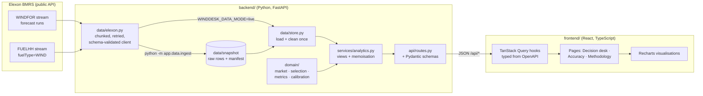

# Architecture

This document is for reviewers and maintainers. For the analysis itself, see [ANALYSIS.md](ANALYSIS.md).

## System overview

**Runtime shape.** One FastAPI process serves `/api/*` and, when `WINDDESK_STATIC_DIR` is set, the built SPA for every
other path. Docker and Heroku run exactly that. On Vercel, the SPA is served from Vercel's CDN, and `/api/*` is rewritten
to `api/index.py`, which imports the same app. One codebase supports three deploy targets.

## Backend layers

| Layer | Responsibility | Depends on |
|---|---|---|
| `domain/` | Pure functions: market conventions, forecast selection, metrics, calibration. No I/O, no HTTP, no globals. | pandas, numpy |
| `data/` | Getting data in: Elexon client, canonical frame shapes, snapshot store, ingest CLI. | `domain/market` (for windows) |
| `services/` | Orchestration: builds each view from domain functions, memoises per instance, formats numbers. | `domain`, `data` |
| `api/` | HTTP: parameter validation, response models, CSV responses. Contains no business logic. | `services` |
| `main.py` | App factory, middleware (gzip, CORS, cache headers), error mapping, SPA serving. | everything |

### The core rule: as-of selection

Every analysis asks the same question per target hour `t`: *which was the latest run published by `cutoff(t)` that
covers `t`?* `domain/selection.select_as_of` answers it with one join and a `drop_duplicates(keep="last")`. Only the
cutoff differs:

- **Day-ahead decision:** `cutoff(t)` = gate closure on the day before `t`'s delivery day (`market.decision_cutoffs`).
- **Fixed lead time:** `cutoff(t) = t − h`.

Because both bases share this function, they cannot drift apart. The per-target selection also handles a run that
doesn't cover every hour: that hour falls back to the newest run that does cover it (tested).

### Time

All market rules are written in UK local time (`zoneinfo` `Europe/London`) and converted to UTC, so gate closures and the
23:00–23:00 delivery day stay correct across BST changes (tested with summer dates and a 23-hour clock-change day).
The API speaks UTC ISO-8601; the UI formats everything in UK time.

### Calibration without look-ahead

`domain/calibration.fit(training, as_of, window_days)` uses only pairs whose outturn **publish time** is at or before
gate closure, within the trailing window, from runs with day-ahead-like lead times (12–40 h). Tests prove:
1. future outturn can be replaced with random noise and the calibration is unchanged;
2. outturn published late is excluded, even if its period is old.

### Data handling

- The snapshot stores **raw** Elexon rows (gzipped CSV, 130 KB) plus a manifest of the exact request windows.
  Cleaning (UTC normalisation at ns resolution, dropping backward-looking forecast rows, de-duplication) happens in
  `frames.py` on every load, so live and snapshot data go through the same code path.
- `WINDFOR` rows are schema-validated with Pydantic on ingest; a schema change fails loudly instead of corrupting data.
- Requests are chunked by week and retried with backoff on 429/5xx; 4xx errors fail fast.
- A 7-day warm-up before 1 January is loaded only so the first decision's calibration has a full window. It never
  appears in any analysis.

### Performance

The full dataset is about 23k forecast rows and 1.9k actuals, so everything runs in memory with pandas.

| Operation | Cold | Warm |
|---|---|---|
| Load + clean snapshot | ~70 ms | — |
| Decision view (one day) | ~110 ms | <10 ms |
| Accuracy view (month) | ~130 ms | ~40 ms |
| Lead-time curve (49 horizons) | ~0.8 s | <20 ms |

Results are memoised per `WindAnalytics` instance (`functools.cache` on bound methods). The dataset is immutable, so
caches never go stale. API responses carry `Cache-Control: s-maxage=86400` for CDN caching, and are gzipped (a decision
view is about 3.6 KB on the wire).

**Serverless:** the analytics object is built lazily on first data request (thread-safe), so `/api/health` costs nothing
on a cold start. A lifespan hook pre-warms it where lifespan is supported.

## Frontend

- **Stack:** React 19, TypeScript (strict), Vite 8 (Rolldown), Tailwind CSS 4, TanStack Query 5, React Router, Recharts 3.
- **Types from the backend:** `python -m app.openapi` → `openapi.json` → `npm run gen:api` → `schema.d.ts`.
  `api/types.ts` gives friendly aliases. CI fails if either generated file is stale.
- **Server state:** TanStack Query with `staleTime: Infinity`, because the data is historical. `keepPreviousData` holds
  the last render at reduced opacity while the next one loads, so the layout never jumps.
- **URL as state:** date, auction, toggles, basis, horizon and date range are all query parameters, so every view can
  be shared or bookmarked and survives refresh and back/forward.
- **Code splitting:** the landing page is in the main chunk; the Accuracy and Methodology pages lazy-load. React and
  chart vendor code are separate long-cache chunks.
- **Design system:** CSS custom properties for roles (`--ink`, `--surface`, `--c-forecast`…) power both themes and the
  charts. Series colours come from a palette validated for colour-vision deficiency in both themes. Status colours
  always pair with an icon and label.
- **Accessibility:** chart regions are labelled, the calendar is a keyboard-navigable listbox, every chart has a table
  view or CSV, focus rings are visible, and reduced motion is respected.

## Testing strategy

| Suite | What it guards |
|---|---|
| `test_market.py` | Gate closure and delivery-day rules in GMT, BST and on clock-change days |
| `test_selection.py` | As-of selection: inclusive cutoff, after-gate runs excluded, fallback, horizon basis |
| `test_calibration.py` | Ratio-of-sums factor, **no look-ahead**, late-published outturn excluded |
| `test_metrics.py` | Error sign convention, statistics, histogram, level ratios, delivery-day energy |
| `test_elexon.py` | Chunking, de-duplication, fuel filter, retries, fail-fast and schema drift (mock transport) |
| `test_store.py` | Snapshot round trip keeps raw rows; live mode fetches once, then uses the cache |
| `test_api.py` | Contract tests on real data: information boundary at the gate, 404/422 mapping, CSV, SPA fallback, path traversal |
| `test_snapshot_invariants.py` | Completeness of the snapshot and pinned headline numbers |
| `frontend/**/*.test.ts(x)` | UK-time formatting (GMT/BST), colour scales, API client errors, calendar keyboard and hindsight guard |

Backend coverage is 94%.

## Decisions and trade-offs

| Decision | Why | Trade-off |
|---|---|---|
| Committed data snapshot as the default source | Deterministic demo, instant cold starts, works offline, reproducible numbers | Must re-run ingest to refresh (live mode exists) |
| pandas in memory, no database | Data fits easily in memory; zero ops | Would need a store such as Postgres/Timescale for multi-year or live use |
| Exact timestamp join (hourly forecast vs half-hour actual at the hour) | Matches the brief's field mapping; transparent | Ignores the second half-hour of each hour in point metrics (daily energy uses all of them) |
| Multiplicative trailing calibration | Error is proportional to wind level; explainable to traders; causal | Reacts with a lag to regime changes |
| Single container (API serves SPA) | One deployable, same origin, no CORS in production | UI and API scale together |
| Hand-written UI primitives instead of a component library | Small bundle, full control over the data-dense layout | More code to own |

## Extending

- **Another fuel type or dataset:** add a client method in `data/elexon.py` and a frame shape in `frames.py`; the domain
  functions are dataset-agnostic.
- **Another auction:** add a `GateClosure` to `market.GATE_CLOSURES` and to the `GateId` literal (a test checks they match).
- **Operational use:** set `WINDDESK_DATA_MODE=live`, move the window to "today", and schedule `app.data.ingest`.
